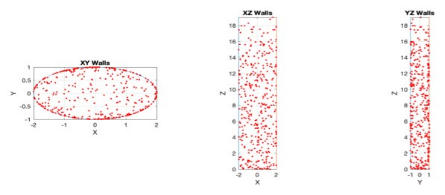
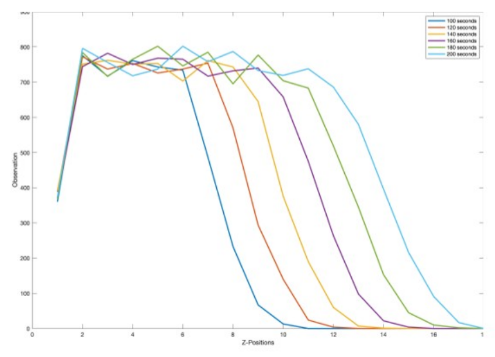
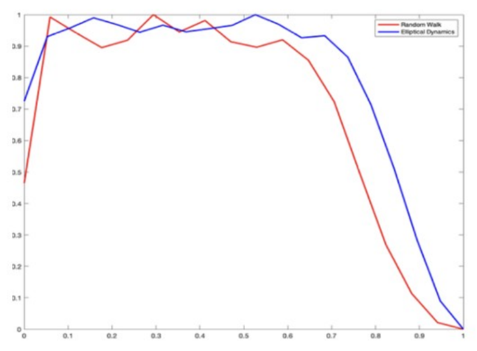
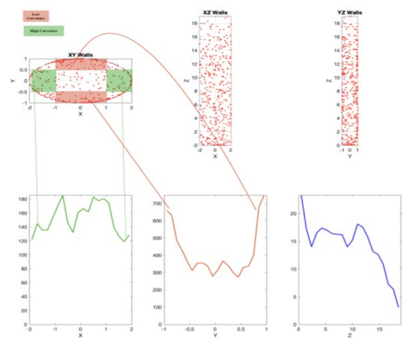

# Simulated Nanorods' Behavior Under Flow

## Overview

Working alongside Dr. Mykhailo Potomkin[^1], we simulated nanorods swimming upstream in an elliptical channel. Its 2D model, the **Elliptical Dynamics Simulator (E.D.S.)**, produces concentration profiles of the rods along the channel. These profiles are compared with a **one-dimensional biased random walk**.

Main findings:

- The concentration profiles match a biased random walk with an **exponential run-time distribution**.
- The simulations capture how the nanorods interact with the channel walls as they migrate upstream.
- Because a 1D random walk can reproduce the profiles, upstream transport can be modeled with **much less computation**.

## Background

Nanorods behave like micro-swimmers, which lets them move upstream against a flow. E.D.S. tracks where the rods build up, their contamination profiles, inside an elliptical channel.

The 3D channel is shown as two 2D views:

- **XZ view:** rod positions along the x and z coordinates
- **YZ view:** rod positions along the y and z coordinates

The elliptical cross-section (xy-plane) shows how rods are spread over the channel surface. It is like looking down the inside of a tube.

*Fig. 01: End state of an E.D.S. run: XY (cross-section), XZ and YZ views of rod positions.*

## Results

### Concentration profiles over time (Fig. 02)

Each curve counts the swimmers along the z-axis at one point in time. Over time, the flat (plateau) part of the profile gets longer and the point where concentration drops off moves farther up the channel. **The longer the rods migrate, the higher up the channel they build up.**

*Fig. 02: Concentration vs. z-position at several times.*

A profile shaped by exponential run times means **more rods travel farther upstream** than with a power-law run-time distribution.

### Random walk vs. E.D.S. (Fig. 03)

Figure 03 overlays a profile from a random walk with exponential run times on the E.D.S. profile. Both are min-max normalized. The two curves closely agree.

*Fig. 03: Normalized profiles: random walk (red) vs. elliptical dynamics (blue).*

### Preference for low-curvature walls (Fig. 04)

During upstream transport, rods gather in the **low-curvature regions** of the elliptical cross-section. The reason is still unclear and needs more study.

*Fig. 04: Rod distribution in low- vs. high-curvature regions of the cross-section, with x, y and z histograms.*

## Discussion

- **Contrast with the Super-Contamination article^[2]:** In that study, a *rectangular* channel produced profiles matching a biased random walk with a **power-law** run-time distribution. Here the elliptical channel matches an **exponential** distribution. The different channel shapes are thought to explain this.
- **Advection can mimic a power law:** The biased random walk was run with both exponential and power-law run distributions. Even with exponential run times, long enough downstream advection distances made the walk *look* like a power-law distribution.
- **Limitations:** Time limits left some observations without further evidence. Only Euler's method was used to integrate rod positions, and more accurate numerical methods might give better approximations.
- **Future work:** Find out what controls the 1D random-walk distribution profiles, and why rods prefer low-curvature walls.

## Methods

### Elliptical Dynamics Simulator (E.D.S.)

Nanorod positions are approximated with **Euler's method**. The model's inputs are:

- flow rate, $F_{rate}$
- ellipse radius in x, $r_a$
- ellipse radius in y, $r_b$

A random value $\alpha \in [0, 1]$ is generated, and the orientation angles are limited to

$$0 \le \theta \le 2\pi, \qquad 0 \le \phi \le \frac{\pi}{2}$$

The update equations, as given in the paper:

$$x_n = \cos(\theta_{n-1})\sin(\phi_{n-1}), \qquad y_n = \sin(\theta_{n-1})\sin(\phi_{n-1})$$

$$z_n = \cos(\phi_{n-1}) + F_{rate}\left[\left(\frac{x_{n-1}^2}{r_a^2} + \frac{y_{n-1}^2}{r_b^2}\right) - 1\right]$$

$$\theta_n = F_{rate}\left(-\sin^2(\theta_{n-1})\cos(\phi_{n-1})\,\frac{2x_{n-1}}{r_a^2} + \sin(\phi_{n-1})\,\frac{2y_{n-1}}{r_b^2}\right)$$

### One-dimensional biased random walk

- The downstream displacement time is fixed.
- The **Metropolis algorithm** changes swimming directions and randomly draws upstream travel distances.
- Both exponential and power-law run-time distributions were tested.

## Figures

| Figure | Content |
|---|---|
| Fig. 01 | End state of an E.D.S. run: XY (cross-section), XZ and YZ views of rod positions |
| Fig. 02 | Concentration vs. z-position at several times |
| Fig. 03 | Normalized profiles: random walk (red) vs. elliptical dynamics (blue) |
| Fig. 04 | Rod distribution in low- vs. high-curvature regions of the cross-section, with x, y and z histograms |

[^1]: https://sites.google.com/view/mpotomkin
[^2]: https://www.science.org/doi/10.1126/sciadv.aay0155
